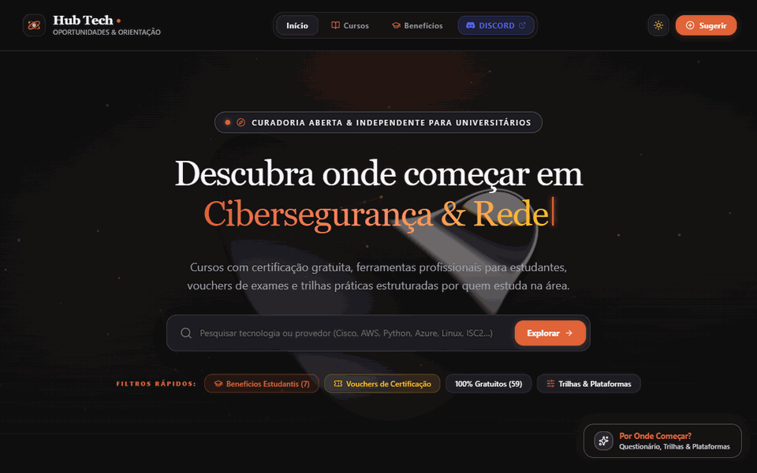
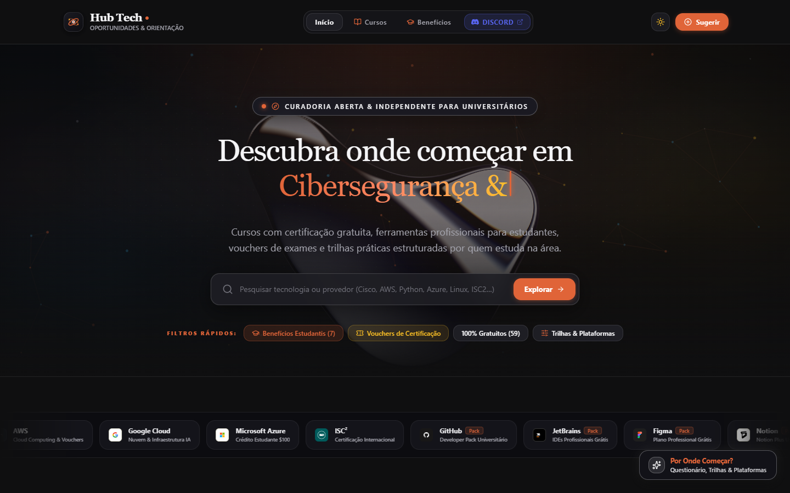
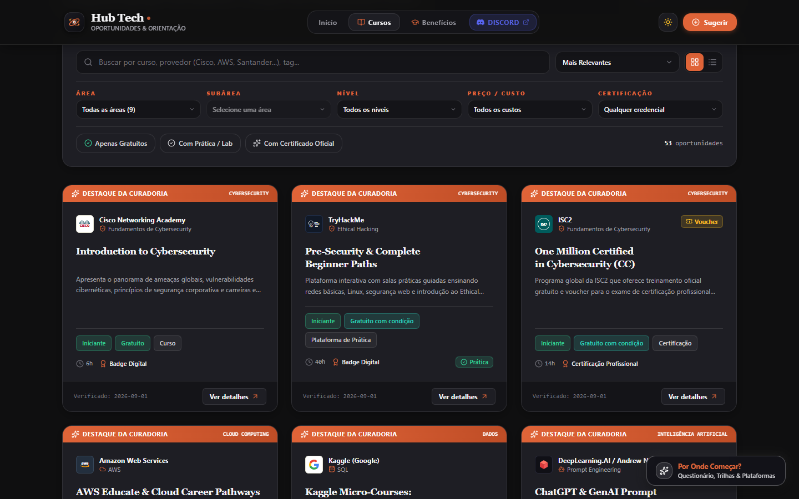
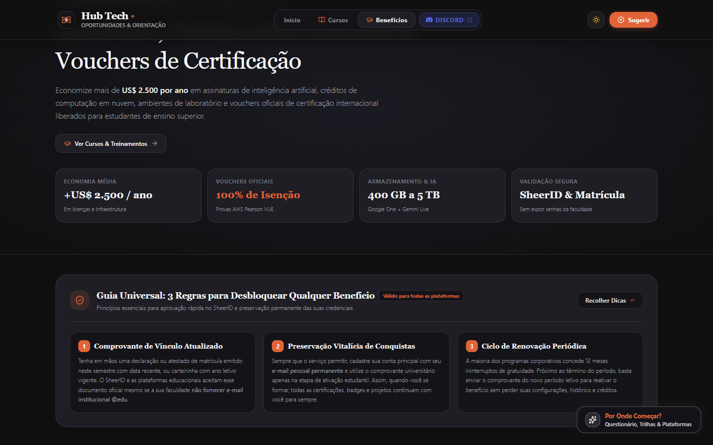
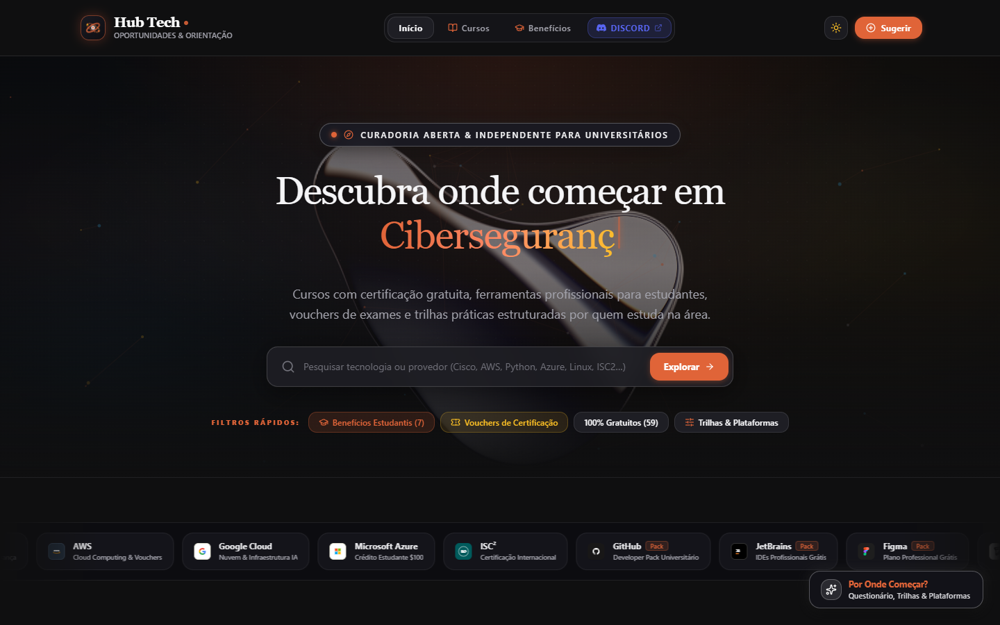

# 🎓 HubTech — Hub de Oportunidades & Curadoria em Tecnologia

  

  <strong>Plataforma web colaborativa de descoberta, curadoria e orientação de oportunidades educacionais em tecnologia para estudantes universitários.</strong>

  

  
  
  
  
  
  
  
  

---

## 🌐 Acesso Online

A plataforma está em produção e aberta para acesso:

👉 **[https://hub-tech.vercel.app/](https://hub-tech.vercel.app/)**

---

## 🎬 Demonstração da Plataforma

*Fluxo completo de navegação: rolagem da página inicial, catálogo de cursos com filtros por área, central de benefícios universitários e painel de orientação "Por Onde Começar?".*

---

## 📸 Telas da Plataforma

<table>
<tr>
<td width="50%">

**1. Página Inicial (Hero & Apresentação)**

</td>
<td width="50%">

**2. Catálogo de Cursos & Certificações**

</td>
</tr>
<tr>
<td width="50%">

**3. Central de Benefícios Universitários**

</td>
<td width="50%">

**4. Modal de Detalhes da Oportunidade**

</td>
</tr>
</table>

### Painel de Orientação ("Por Onde Começar?")

*Painel lateral interativo voltado especialmente para alunos de início de curso, com diagnóstico por interesses, trilhas técnicas e plataformas parceiras.*

---

## 🎯 O problema que o projeto resolve

Quem ingressa na faculdade de tecnologia (especialmente nos primeiros semestres) frequentemente enfrenta dois grandes obstáculos:

1. **Dispersão de oportunidades:** Existem dezenas de cursos gratuitos de peso internacional (Cisco Networking Academy, IBM, Microsoft, Santander Open Academy) e ferramentas profissionais com acesso gratuito para universitários (GitHub Student Developer Pack, JetBrains, Azure for Students, AWS Educate), mas essas oportunidades ficam espalhadas pela internet sem um ponto central.
2. **Falta de direcionamento:** O aluno iniciante muitas vezes não sabe por onde começar, quais pré-requisitos precisa cumprir ou como aproveitar essas oportunidades para enriquecer o currículo e validar horas complementares.

O **HubTech** centraliza, filtra e organiza essas oportunidades em um único ambiente moderno, gratuito e colaborativo.

---

## 💡 Filosofia do HubTech

- **Curadoria, não competição:** O HubTech não concorre com provedores educacionais. Ele atua como uma camada inteligente de curadoria e direcionamento, encaminhando o aluno sempre para o link e provedor oficial.
- **Liberdade de escolha:** Apresenta caminhos, fundamentos e trilhas como possibilidades para o estudante construir sua própria jornada, sem impor regras rígidas.
- **Espírito colaborativo:** Os próprios alunos podem submeter novas plataformas, cursos e benefícios que descobriram, alimentando a base para toda a comunidade.

---

## ⚙️ Funcionalidades Implementadas

- **Catálogo de Cursos & Certificações:** Filtros dinâmicos por área técnica (Frontend, Backend, DevOps & Cloud, Segurança da Informação, Dados & IA, etc.), nível de dificuldade e emissão de certificado.
- **Central de Benefícios Estudantis:** Lista curada de ferramentas de desenvolvimento, IDEs e créditos em nuvem liberados para quem possui e-mail universitário.
- **Modal de Detalhes Contextualizado:** Informações sobre carga horária, idioma, pré-requisitos, notas de aproveitamento e link direto para o site oficial.
- **Painel "Por Onde Começar?":** Drawer interativo com questionário de autoavaliação, catálogo de trilhas por área e visão geral das principais plataformas de ensino.
- **Submissão Comunitária:** Modal para que estudantes possam indicar novos cursos e benefícios diretamente pela plataforma.
- **SEO & Otimização:** Metatags completas, Schema.org (JSON-LD), sitemap dinâmico e renderização veloz.

---

## 🛠️ Stack Tecnológica & Arquitetura

### Frontend
- **React 19:** Utilização das APIs mais recentes do ecossistema React.
- **TypeScript:** Tipagem estática em 100% dos componentes e contratos de dados.
- **Vite:** Build tool de alta performance para desenvolvimento e bundle otimizado.
- **Tailwind CSS 4:** Estilização utilitária moderna com design tokens.
- **Motion (`motion`):** Animações fluidas de interface, transições de páginas e modais.
- **Shaders React (`@paper-design/shaders-react`):** Efeito visual líquido no background para identidade visual dark e imersiva.
- **Lucide Icons:** Conjunto de ícones vetoriais leves e consistentes.

### Backend & Banco de Dados
- **Node.js & Express:** Camada de API para gerenciamento de dados, rotas de consulta e submissões.
- **Supabase (PostgreSQL):** Banco de dados relacional gerenciado na nuvem.
  - Tabela `opportunities`: Cadastro de cursos, certificações, tags, cargas horárias e metadados.
  - Tabela `submissions`: Fila de oportunidades enviadas pela comunidade para triagem.
  - Tabela `admin_users`: Controle de acesso administrativo.
- **Segurança & Validação:** Validação estrita de schemas com **Zod**, autenticação via **JWT** e hashing de senhas com **bcryptjs**.

### Deploy & Infraestrutura
- **Vercel:** Hospedagem com distribuição global por CDN e suporte a Serverless Functions.

---

## 👨‍💻 Autor & Concepção

<table style="border: none;">
<tr>
<td width="80" valign="middle">
  
</td>
<td valign="middle">
  <strong>Pedro Henrique Caputo</strong> 
  Idealizador e Desenvolvedor do HubTech 
  Estudante de Ciência da Computação — Universidade Cruzeiro do Sul 
  <a href="https://www.linkedin.com/in/pedro-caputo/">LinkedIn</a> • <a href="https://github.com/pedro-caputo">GitHub</a>
</td>
</tr>
</table>

---

## 📄 Licença

Este projeto está sob a licença [MIT](LICENSE).
